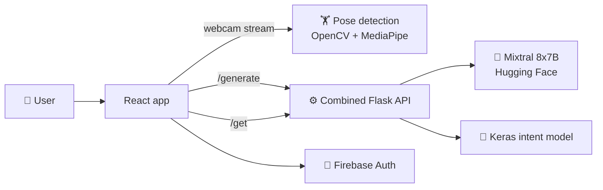

<div align="center">


# 💪 FitZen · Aura Hackfest Edition

### Your AI workout buddy, nutritionist and wellness coach in one app.

The final Aura Hackfest version of FitZen by team **BroCode**: webcam rep counting, LLM meal plans and a mental health chatbot, served from a single combined backend.


</div>

---

## 💡 The problem

Staying healthy usually means juggling a fitness app, a diet app and, if you can afford it, a trainer and a therapist. Most people end up with no feedback on their form, generic diet plans, and nowhere to turn on a bad mental-health day.

## ✨ The solution

FitZen brings fitness, nutrition and mental well-being into one place. Your webcam becomes a personal trainer that counts reps and checks form, an LLM writes a meal plan for your goals, and a chatbot is available whenever you need to talk.

## 🎬 Demo

<div align="center">

<a href="https://youtu.be/HgBd2bfBc9U">
  
</a>

▶️ **[Watch the walkthrough](https://youtu.be/HgBd2bfBc9U)** · 📑 **[Pitch deck](BroCode_AuraHackfest.pdf)**

</div>

## 🚀 Features

| | Feature | What it does |
|---|---|---|
| 🏋️ | **AI exercise buddy** | Counts push-ups, bicep curls and shoulder presses in real time from your webcam, using pose estimation |
| 🧘 | **Yoga pose detection** | Gives live feedback on your yoga poses in the browser |
| 🍏 | **AI meal plans** | Generates a diet plan for your goals and preferences with an LLM (Mixtral 8x7B) |
| 🧠 | **Mental health chatbot** | Intent-based chatbot that offers support and guidance |
| 📊 | **Dashboard** | Tracks your progress with charts and KPIs |
| 🎉 | **Rewards** | Keeps you motivated with milestones and rewards |
| 👥 | **Community and blog** | Posts, events, news and fitness jobs |

## ⚙️ How it works



- **Pose detection:** MediaPipe finds body landmarks in each frame, the angle at the elbow or shoulder decides whether you are "up" or "down", and each full cycle counts as a rep.
- **Combined API (`fitzen-backend/app.py`):** one Flask server handles both the chatbot (`/get`) and meal plans (`/generate`), so the frontend talks to a single backend.
- **Meal plans:** the user's goals become a prompt for Mixtral 8x7B on the Hugging Face Inference API.
- **Chatbot:** a small neural network trained on intents classifies each message and picks a matching response.

## 🛠️ Tech stack

| Layer | Technology |
|---|---|
| Frontend | React, Tailwind CSS, Material UI, Redux Toolkit, Chart.js, Nivo |
| In-browser AI | TensorFlow.js, PoseNet, MediaPipe Tasks |
| Backend | Python, Flask, Flask-SocketIO |
| Computer vision | OpenCV, MediaPipe |
| AI models | Mixtral 8x7B (Hugging Face), Keras intent classifier |
| Auth | Firebase Authentication |

## 📁 Project structure

```
aura_hackfest_fitzen_bro-code/
├── src/                          # React frontend
│   ├── Landing/                  # Landing page
│   ├── Login_Signup/             # Authentication
│   ├── Main/                     # Dashboard, exercise, meal plan, mental health, rewards, profile
│   ├── Community/                # Community feed
│   └── Blog/                     # News, events and jobs
├── public/
├── fitzen-backend/
│   ├── app.py                    # Combined API: chatbot (/get) + meal plans (/generate)
│   ├── aimealplan.py             # Standalone meal-plan API
│   ├── pose_detection/           # Rep counters for push-ups, curls and shoulder presses
│   ├── chatbot/                  # Chatbot model, intents and standalone API
│   ├── templates/                # Pages for the rep-counter video feeds
│   └── fitzen-requirements.txt
└── BroCode_AuraHackfest.pdf      # Pitch deck
```

## 🏃 Getting started

**Prerequisites:** Node.js 18+, Python 3.9+, a webcam, a Firebase project and a Hugging Face token.

**1. Frontend**

```bash
npm install
npm start
```

Opens at `http://localhost:3000`.

**2. Backend**

```bash
cd fitzen-backend
pip install -r fitzen-requirements.txt
python app.py
```

Before running:

- Set your Hugging Face token in `app.py` (better: read it from an environment variable).
- `app.py` loads the chatbot model with absolute Windows paths from the original machine. Change them to `chatbot/intents.json`, `chatbot/texts.pkl`, `chatbot/labels.pkl` and `chatbot/model.h5`.

Rep counters run separately, for example:

```bash
cd fitzen-backend/pose_detection && python bicep_curl.py
```

## 👥 Team BroCode

Built at Aura Hackfest. Original code by [hargun13](https://github.com/hargun13) and team BroCode.

---

<div align="center">

Made with 💙 by team BroCode

</div>
